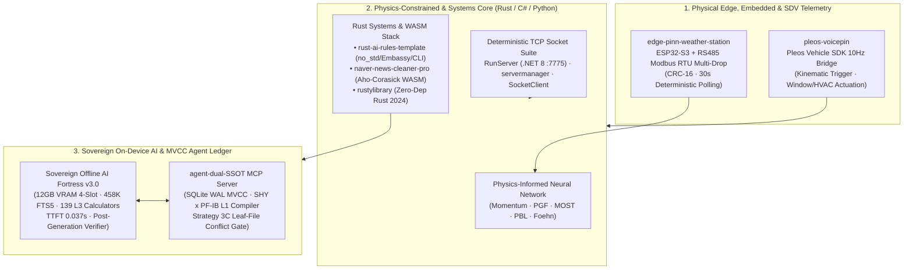

# 🛡️ Engineering Portfolio & Sovereign AI Architecture Hub (`tejo1990`)

[](https://tejo1990.github.io)
[](#2-what--대표-플래그십-프로젝트-인덱스-flagship-projects)
[](#4-카테고리별-전체-공개-저장소-맵)

> **하드웨어 센서 버스(RS485 Modbus RTU · 차량용 SDV 텔레메트리)부터 물리 법칙 제약 신경망(PINN), 온디바이스 결정론적 LLM 아키텍처, MVCC 에이전트 상태 원장까지 — 확률적 환각과 런타임 비결정성을 시스템 엔지니어링으로 제어하는 통합 기술 포트폴리오 허브입니다.**

🌐 **인터랙티브 아키텍처 포트폴리오 바로가기 (`🌱 쉽게 읽기` ↔ `⚙️ 엔지니어 원문` 전환 지원)**: **[https://tejo1990.github.io](https://tejo1990.github.io)**

---

## 1. Why — 엔지니어링 철학 및 해결하려는 핵심 문제

실제 물리 현장(미세기상 관측소, 주행 중인 차량, 폐쇄망 업무 PC, 멀티클라이언트 소켓 서버)에서는 클라우드 API 의존성이나 확률적 AI 모델의 암산·환각·비결정적 지연이 곧바로 안전 및 데이터 무결성 장애로 이어집니다.

본 포트폴리오의 프로젝트들은 공통된 **3대 결정론적 시스템 설계 원칙(Deterministic Engineering Principles)** 위에 구축되었습니다.

1. **하드웨어·프로토콜 계층의 결정론 확보**: RS485 반이중(Half-Duplex) 멀티드롭 슬레이브 충돌 해결 및 CRC-16 검증, SDV 10Hz 텔레메트리 디바운싱(`<1% CPU`), TCP 패킷 프레이밍(`NDJSON` / `<EOP>`)과 워치독으로 유실·경합 없는 수집 파이프라인을 구축합니다.
2. **물리 법칙 및 순수 수리 검증기 결합 (`Physics & AST Guardrails`)**: 순수 데이터 기반 블랙박스 추론의 외삽 오류를 막기 위해 운동량 보존·단열 감률·Monin-Obukhov 상사 이론을 손실함수에 결합한 **PINN**과 **139종 순수 Python 표준 라이브러리 계산 외골격**으로 오차를 통제합니다.
3. **내결함성 로컬 퍼스트 저장소 (`SQLite WAL & MVCC`)**: 전원 급차단(Ignition-Off) 및 병렬 세션 동시 쓰기 환경에서도 데이터 손상과 Split-Brain이 발생하지 않도록 SQLite WAL, 7자리 GeoHash 공간 색인, MVCC 3-Tier 스냅샷 원장을 적용합니다.

---

## 2. What — 대표 플래그십 프로젝트 인덱스 (Flagship Projects)

| 프로젝트 저장소 | 도메인 & 핵심 스택 | 해결 문제 및 엔지니어링 핵심 요약 |
| :--- | :--- | :--- |
| **[`edge-pinn-weather-station`](https://github.com/tejo1990/edge-pinn-weather-station)** | **Embedded Telemetry & Real-Time Physics AI**<br/>`ESP32-S3` · `RS485 Modbus RTU` · `PyTorch PINN` · `Vertex AI` · `Cloud Run` | 5km 종관 기상 격자가 놓치는 국지 푄(Foehn)·복사냉각·돌풍을 포착하기 위해 3종 산업용 RS485 센서 멀티드롭 버스와 대기물리 지배방정식(PGF·MOST·PBL·Foehn) 기반 실시간 PINN 나우캐스팅 및 Dual-Mode 관제 대시보드 구현 |
| **[`pleos-voicepin`](https://github.com/tejo1990/pleos-voicepin)** | **SDV In-Vehicle Safety & Actuation**<br/>`Kotlin 17` · `Android API 34` · `Hyundai Pleos SDK 5종` · `SQLite WAL` · `GeoHash-7` | 현대차그룹 Pleos 공모전 출품작. 조향각·제동·ESC 경고등 물리 거동으로 화면 터치 없이 5초 보이스 핀 및 무터치 SOS를 발송하고, 전방 추돌·연기 구간 진입 전 1-Tap IC 우회 및 창문(0%)·내기순환 역제어 수행 |
| **[`Sovereign Offline AI Fortress v3.0`](https://tejo1990.github.io)** *(본 저장소)* | **On-Device LLM Systems Engineering**<br/>`RTX 3060 12GB` · `SQLite FTS5` · `BGE-M3` · `Pure Python AST/HWP/PPTX/XLSX/DOCX` | 단일 보급형 GPU(12GB VRAM) 폐쇄망 환경에서 4-슬롯 VRAM 격리, 45.8만 건 FTS5 카트리지, 순수 파이썬 `.hwp`/`.hwpx`/`.pptx`/`.xlsx`/`.docx` 구조 보존 파서, N-gram 투기적 디코딩(`TTFT 0.037s`), 사후 숫자·조문 역검증기로 골든 벤치마크 `50/50(100%)` 달성 |
| **[`agent-dual-SSOT`](https://github.com/tejo1990/agent-dual-SSOT)** | **Deterministic Agent Memory & MCP**<br/>`Python 3.10+` · `MCP (<500 tok)` · `SQLite WAL MVCC` · `Pydantic v2` | 멀티세션 Split-Brain과 컨텍스트 부패를 막는 MVCC 3-Tier 원장. `SHY × PF-IB` 5변수 라그랑주 점수 기반 L1(`100줄/1,500토큰`) 자동 컴파일러, 리프 파일 충돌 탐지(`Strategy 3C`), `tx_id` 원자적 롤백 지원 |
| **[`rust-ai-rules-template`](https://github.com/tejo1990/rust-ai-rules-template)** | **Rust Embedded/Systems DevOps & MCP**<br/>`Rust` · `no_std / Embassy / RTIC` · `Axum` · `Docker MCP` · `GitHub Actions` | `embedded`·`systems-cli`·`web-axum` 도메인별 메모리/비동기 불변식, 파일 소유권이 분리된 AI-TDD 멀티에이전트 규율, 화이트리스트 Cargo 샌드박스 MCP 서버(`:3008`), 주간 Rust 생태계 자동 PR 파이프라인 |
| **[`naver-news-cleaner-pro`](https://github.com/tejo1990/naver-news-cleaner-pro)** | **Rust/WebAssembly Browser Systems**<br/>`Rust (aho-corasick)` · `wasm-bindgen` · `Chrome MV3` · `Gemini 2.5 Proxy` | 다중 키워드·언론사·감성 어휘를 단일 패스 $O(N)$ `Aho-Corasick` WASM 오토마타와 MV3 CSP-Safe 선형 메모리 로더로 실시간 차단하고, 서버리스 프록시 기반 기사 객관성·편향성 분석 모달 제공 |

---

## 3. How — 포트폴리오 아키텍처 맵 & 로컬 LLM 고도화 21부작

### 3.1 엔지니어링 도메인 연결 아키텍처



### 3.2 로컬 LLM 고도화 본편 21부작 (`Sovereign Offline AI Fortress v3.0`)

> **1분 요약**: 인터넷 연결 없이 일반 보급형 그래픽카드 1장(`RTX 3060 12GB`)이 장착된 로컬 PC 안에서 **거짓말 0% · 수식 계산 오차 0% · 외부 유출 0%**를 달성하기 위해 `Stage 1`부터 `Stage 21`까지 실제 병목을 하나씩 격파하며 구축한 엔지니어링 기록입니다.

#### 왜 `$6,950` 전용 로컬 기기(`DGX Spark 128GB` + 최신 `Gemma 4 31B` / `gpt-oss 120B` 단독 구동)로도 `L2·L3` 외골격을 대체할 수 없는가?

| 비교 차원 및 세부 지표 | 💎 프리미어 기기 + 최신 모델 단독 (`Naked L1`)<br/>`DGX Spark 128GB ($6,950)` + `Gemma 4 31B` / `gpt-oss 120B` | 🏰 본 프로젝트 (`Sovereign Fortress v3.0`)<br/>`RTX 3060 12GB ($280)` + `14B` + `L2(FTS5·HWP)` + `L3(Python)` | 물리·전산학적 원인 및 하드웨어 경계 조건 |
| :--- | :---: | :---: | :--- |
| **① 비공개 실무 문서(`.hwp`·`.hwpx`·`.pptx`·`.xlsx`·`.docx`) 실시간 드래그앤드롭 판독** | **`0.0%` (판독 불가)** | **`100.0%`** (`9.6~31.5ms` 파싱 · `138.9ms` 암호화 색인) | 파라미터 크기와 무관하게 `MS-CFB`·`OOXML` 병합 표·변경추적(`<w:del>`) 파서와 로컬 `L2` 색인기가 없으면 디스크 문서를 읽지 못함 |
| **② 적대적 거짓 법령·숫자 유도 질문 방어 (`Golden Axis 2`)** | **취약** (`RLHF` 동조·단서조항 환각) | **`10 / 10 (100.0%)` 사전 차단** | 가중치 내부 지식은 파라미터당 `2 bits` 손실 압축 상태라 세부 예외 조항(`상임법 제2조 제3항` 등)에서 질문자 편향에 동조함 |
| **③ 복합 실정법·재무 원(₩) 단위 정밀 산출 (`Golden Axis 3`)** | **`0%` 무결성 보증 불가** (확률 토큰 암산) | **`10 / 10 (100.0%)` · 오차 `0.0%`** (`5.94ms` 다중 `L3` 배치) | 트랜스포머는 `ALU`가 아님. 분기 조건이 겹치는 일할 지연이자(`102,547,945원`)·호프만 상한(`240`) 암산은 필연적으로 틀림 |
| **④ 생성 답변 내 `0` 누락(`9억→9천만`)·가짜 조문 검문 (`Axis 5`)** | **`0.0%` (자가 검문 루프 없음)** | **`10 / 10 (100.0%)` 적발·자동 교정** | 순정 `L1`은 스스로 출력한 만·억 단위와 천 단위 쉼표 간 `10배` 자릿수 오타(`ZERO_DIGIT_SHIFT_10X`)를 역검증하지 못함 |
| **⑤ 3년 총소유비용(`TCO`) 및 실시간 출력 속도** | **`$7,088`** · `31B Dense` **`11.1 tok/s`** (`273 GB/s` 병목) | **`$448` (비용 `1/15.8`)** · **`33.4 tok/s`** (`TTFT 0.037~0.049s`) | `DGX Spark`는 `256-bit LPDDR5x(273 GB/s)` 대역폭 한계로 `Dense` 생성이 느리며, `<think>`로만 수식을 풀면 수십 초 지연됨 |
| **⑥ [정직한 역비교] 미수록 범용 코딩·대학원 추론 (`LiveCodeBench` / `GPQA`)** | **🏆 대형 체급 우위** (`80.0~87.8%` / `78.5~84.3%`) | `62.5~72.0%` / `70.4%`<br/>(`12GB VRAM` 내 `SLOT_2 ≤ 9.8GB` 한계) | **`SLOT_2` 물리 경계 & 직교성(`L1 ⊥ L2·L3`)**: `12GB VRAM + 16GB RAM` 본체에 `Gemma 4 26B MoE(15.9GB)`를 억지로 넣으면 활성 연산(`3.8B`)과 무관하게 전체 가중치가 넘쳐 DDR4 스와핑(`6.2 TPS`)·가상메모리 `OOM`이 터지므로 `≤9.8GB` 모델(`Qwen3-14B 8.4GB` / `Gemma 4 12B 7.4GB`)만 `100% VRAM`에 적재함. 상위 장비(`24GB+ VRAM / 32GB+ UMA`) 배포 시 `L2·L3` 수정 `0줄`로 `SLOT_2`만 `26B/31B`로 격상해 범용 체급까지 흡수함 |

| 단계 | 포스트 (1:1 대응) | 마주친 현실 병목 (발전 이유) | 핵심 엔지니어링 해법 및 정량 성과 |
| :---: | :--- | :--- | :--- |
| **Stage 1** | **[1부: 질문 탈앵커링 & 순수 파이썬 AST 검증 골격](posts/01-stage1-deterministic-python-verification-backbone.md)** | 아부 편향·암산 환각·패키지 의존성 부패 | `De-anchoring` + `Pure Python AST` 게이트 · 토큰 **`99.76%` 절감** |
| **Stage 2** | **[2부: 13.9GB 100% VRAM 4-슬롯 금고 & 가상메모리 OOM 가드](posts/02-stage2-13gb-vram-vault-and-virtual-commit-guard.md)** | `44GB` 스와핑 속도 급락 & 윈도우 Commit `Vulkan OOM` | **`13.90 GB` 4-슬롯**(`14B` `31~35 TPS` / `4B` `71+ TPS`) + 상위 점유 앱 사전 차단 |
| **Stage 3** | **[3부: 64KB 제자리 HWID 헤더 잠금 & Zero-Argv 런처](posts/03-stage3-zero-leak-64kb-hwid-header-lock.md)** | `.gguf`/`.sqlite` 무단 USB 복사 및 작업 관리자 CLI 노출 | **`64KB` 제자리 헤더 잠금(`~41.5 ms`, 추가 용량 `0B`)** + 노출 인자 `0개` |
| **Stage 4** | **[4부: 45.8만 건 5-스코프 불변 지식 카트리지 & Vision OCR](posts/04-stage4-458k-5scope-cartridge-and-vision-ocr.md)** | `14B` 암기 한계 및 틀린 숫자 전제 동조 | **`458,272건+` `SQLite FTS5`**(한·영 위키+법령+공학+의학+OCR) · 검색 **`30,000x` 가속** |
| **Stage 5** | **[5부: 3-Tier 구어체 쿼리 번역기 & 타이핑 디바운스 격리](posts/05-stage5-3tier-neural-rewriter-and-debounce-isolation.md)** | 일상 구어체 미스 & 타이핑 디바운스 GPU 큐 정체(`89.7초`) | 40선 시드(`<0.05ms`) + 자모 오염 차단 + `?neural=0` 분리(**`89.7s → 22.6s`**) |
| **Stage 6** | **[6부: Adaptive Thinking 제어 & 139종 L3 파이썬 외골격](posts/06-stage6-adaptive-thinking-and-139-l3-exoskeleton.md)** | 로컬 `14B`의 다단계 수리 추론 한계 및 고정 `<think>` 지연 | 난이도별 추론 점화 + **`139종+ vault_stdlib.py` 2-Pass 자율 계산(오차 `0.0%`)** |
| **Stage 7** | **[7부: Edition Isolation 배포 위생 분리 & 25종 표준 템플릿](posts/07-stage7-edition-isolation-and-client-hygiene.md)** | 타 PC 이식·납품 시 개인 문서(`Layer-B`) 혼입 위험 | 빌드 시점 개인 레이어 **물리적 `100%` 소거(`0건` 유출)** + 25종 표준 템플릿 생성 |
| **Stage 8** | **[8부: SSE 실시간 스트리밍 & Zero-VRAM N-gram 투기적 디코딩](posts/08-stage8-sse-streaming-and-zero-vram-ngram-speculative.md)** | 블로킹 응답으로 인한 첫 글자 대기(`8.83~22.6초`) | `SSE` + `KV 프리픽스 슬롯 재사용` + `ngram-mod` · **`TTFT 8.83s → 0.037s (240x 단축)`** |
| **Stage 9** | **[9부: CPU 전용 BGE-M3 시맨틱 사이드카 & 2단계 가중 RRF](posts/09-stage9-cpu-bgem3-hybrid-rrf-zero-vram-reranker.md)** | 전문 용어가 전혀 없는 순수 비유 질문의 어휘 매칭 한계 | `VRAM 0 MiB` CPU `BGE-M3 (:8082)` + `Int8` 코어 구제 · 비유 검색 **`50% → 100%`** |
| **Stage 10** | **[10부: 다중 L3 함수 체이닝 & 사후 답변 숫자·조문 역검증기](posts/10-stage10-post-generation-verifier-and-multitool-l3.md)** | 복합 도메인 계산 누락 & 생성 문장 내 `0` 누락·조문 환각 | `Multi-Tool L3 Batch(5.9ms)` + `ZERO_DIGIT_SHIFT_10X` 사후 검문 · **`10/10` 무결성** |
| **Stage 11** | **[11부: 50문항 5대 축 오프라인 골든 벤치마크 구축 및 종합 성적표](posts/11-stage11-golden-50-benchmark-and-v3-architecture.md)** | 주관적 체감 평가 배제 및 회귀 버그 자동 검출 필요성 | `50문항` 자동 채점 하네스 · **`35/50(70.0%) → 50/50(100.0%)` (`+30.0%p` 실증)** |
| **Stage 12** | **[12부: 순수 파이썬 한글(`.hwpx`·`.hwp` v5.0) 파서 및 내장 표 FTS5 색인기](posts/12-stage12-pure-python-hwp-hwpx-fts5-indexer.md)** | 폐쇄망에서 외부 패키지·한컴 없이 한글 공문서·단가표 해독 불가 | 표준 라이브러리 100% `OWPML`·`MS-CFB` 파서 · **`.hwpx 30.1ms` / `.hwp 9.6ms` 표 직결** |
| **Stage 13** | **[13부: 순수 파이썬 파워포인트(`.pptx`) 슬라이드·병합 표·발표자 노트 색인기](posts/13-stage13-pure-python-pptx-slides-tables-notes-indexer.md)** | 폐쇄망에서 `.pptx` 병합 표 열 밀림 왜곡 및 발표자 노트 누락 | 표준 라이브러리 100% `OOXML` 병합 셀 복원 · **`10슬라이드 23.4ms` · 행 교차 왜곡 방어** |
| **Stage 14** | **[14부: 순수 파이썬 엑셀(`.xlsx`) 다중 시트·병합 셀·수식 색인기](posts/14-stage14-pure-python-xlsx-sheets-merges-formulas-indexer.md)** | 폐쇄망에서 `.xlsx` 2단 병합 헤더·세로 병합·수식 값 누락 | 표준 라이브러리 100% `SpreadsheetML` + `ast` 수식 폴백 · **`10시트 31.5ms` · 품목코드 행 교차 방어** |
| **Stage 15** | **[15부: 순수 파이썬 워드(`.docx`) 변경추적 차단·병합 표·각주 색인기](posts/15-stage15-pure-python-docx-redline-merges-footnotes-indexer.md)** | `.docx` 변경추적 삭제 조항(`<w:del>`) 오염·병합 표 열 밀림·각주 특약 누락 | 표준 라이브러리 100% `WordprocessingML` · **`21.7ms` 파싱 · 구버전 삭제 수치 & 행 교차 방어** |
| **Stage 16** | **[16부: 브라우저 Drag & Drop 실시간 암호화(`ENC_HWID_V2`)·`O(log N)` FTS5 증분 색인기](posts/16-stage16-browser-drag-drop-live-ingest-and-enc-hwid-fts5.md)** | 폴더 열기·`.bat` 실행(`13.4s`) 마찰 및 `2.24 GB` FTS5 `LIKE` 풀스캔 병목 | `POST /api/ingest-file` + `category` 역색인 핀셋 교체 · **`138.9ms` 완결(`96x` 단축) · 무새로고침 반영** |
| **Stage 17** | **[17부: 이종 포맷 다중 문서 1:1 Delta·조항 비교기 & 원시 바이너리 포렌식 무유출 하드닝](posts/17-stage17-multidoc-delta-comparator-and-forensic-hygiene.md)** | `.xlsx` 초안 vs `.docx` 수정본 단위·서식 불일치 & SQLite Freelist 잔류 바이트 | `POST /api/compare-docs` **`4.68ms` 1:1 대조** + `secure_delete` **6대 표면·Raw 바이트 유출 `0건`** |
| **Stage 18** | **[18부: 순수 파이썬 OOXML 서식 워드(`.docx`) & 3-시트 수식 엑셀(`.xlsx`) 오프라인 감사 보고서 익스포터](posts/18-stage18-pure-python-ooxml-audit-report-exporter.md)** | 화면 비교 결과를 결재·발송용 워드/엑셀 문서로 재작성하는 수작업 병목 | `POST /api/export-audit-report` **`.docx 8.3ms` · `.xlsx 5.0ms`** + `SHA-256` 무결성 서명 & `SUM` 수식 내장 |
| **Stage 19** | **[19부: 순수 파이썬 다중 문서 대한민국 법령·독소조항 일괄 리스크 레이더](posts/19-stage19-pure-python-statutory-toxic-clause-risk-radar.md)** | 다수 계약서 중 치명적 법령 위반·독소조항 문서를 선별하는 사전 트리아지 병목 | `POST /api/scan-custom-risks` **`13건 6.48ms` 위험도 순위표** + 하도급·상임법·민법 정량 스코어(`0~100점`) |
| **Stage 20** | **[20부: 법령·독소조항 전수 점검표 통합 `.docx`/`.xlsx` 익스포터 & SQLite 프리리스트·슬랙 무유출 소거](posts/20-stage20-unified-statutory-checklist-export-and-freelist-heal.md)** | 리스크 레이더와 감사 보고서 분리, 프리리스트 드리프트 및 과거 삭제 슬랙 바이트 | `.docx` 제4절(`18.3ms`) · `.xlsx` 4번 시트(`8.2ms`) + **`<0.5ms` 치유 & `2.64GB` 제자리 슬랙 유출 `0건`** |
| **Stage 21** | **[21부: 다중 문서 법정·계약 기한 `D-Day` 레이더 & RFC 5545 한글 `75-octet` 안전 폴딩 `.ics` 익스포터](posts/21-stage21-contract-deadline-radar-and-rfc5545-ics-exporter.md)** | 체결 후 하도급 `10일`/`60일`·상임법 `6~1개월 전` 마감 실기 및 한글 `.ics` 바이트 절단 깨짐 | `POST /api/scan-contract-deadlines` **`13건 11.35ms`** + **`<=75B` UTF-8 안전 폴딩 & `D-3`/`D-1` `VALARM`** |

#### 📎 별첨 연구 노트 (외전 2편)
* **[별첨 A: 단일 프롬프트의 한계를 넘는 '3-Way 서브에이전트 토너먼트' — 250문항 안전·편향 벤치마크 실증](posts/appendix-a-subagent-tournament-250-benchmark.md)**
* **[별첨 B: 멀티세션 Split-Brain을 막는 `Dual-SSOT MVCC` 상태 원장과 `ThreadPoolExecutor` 병렬 수집기](posts/appendix-b-dual-ssot-mvcc-and-parallel-radar.md)**

---

## 4. 카테고리별 전체 공개 저장소 맵

### A. Embedded · SDV · Real-Time Physics AI
- [`edge-pinn-weather-station`](https://github.com/tejo1990/edge-pinn-weather-station) — ESP32-S3 + RS485 Modbus RTU 3종 센서 멀티드롭 텔레메트리 & 대기물리 제약 PINN 실시간 기상 예측 시스템
- [`pleos-voicepin`](https://github.com/tejo1990/pleos-voicepin) — 현대자동차그룹 Pleos Connect SDV 물리 거동 기반 5초 보이스 핀 & 1-Tap 캐빈 실드

### B. Rust Systems · WebAssembly · Agent Infrastructure
- [`agent-dual-SSOT`](https://github.com/tejo1990/agent-dual-SSOT) — SQLite WAL MVCC 세션 격리 및 `SHY × PF-IB` 라그랑주 L1 컨텍스트 컴파일러 MCP 서버
- [`rust-ai-rules-template`](https://github.com/tejo1990/rust-ai-rules-template) — `embedded` / `systems-cli` / `web-axum` Rust 도메인 규칙, AI-TDD 서브에이전트 & Docker/Cargo MCP 스택
- [`naver-news-cleaner-pro`](https://github.com/tejo1990/naver-news-cleaner-pro) — Rust `aho-corasick` WebAssembly 엔진 & Gemini AI 프록시 기반 네이버 뉴스 필터링 확장 프로그램
- [`rustylibrary`](https://github.com/tejo1990/rustylibrary) — 외부 의존성 Zero 순수 Rust(Edition 2024) 대수적 상태 모델링 & CSV 영속화 라이브러리
- [`NewRustean`](https://github.com/tejo1990/NewRustean) — Rust 시스템 프로그래밍 소유권·수명·메모리 모델 레퍼런스 아카이브

### C. TCP Socket Networking & Server Daemon Suite
- [`RunServer`](https://github.com/tejo1990/RunServer) — C# .NET 8 비동기 멀티클라이언트 TCP 소켓(`:7775`, NDJSON 프레이밍) & MySQL 세션 서버
- [`RunServer_DB_socketAPI`](https://github.com/tejo1990/RunServer_DB_socketAPI) — C# TCP-MySQL 소켓 브릿지 및 `<EOP>` 패킷 프레이밍 클라이언트 모듈
- [`servermanager`](https://github.com/tejo1990/servermanager) — 2000ms 주기 TCP 헬스 워치독 및 `<EOP>` 패킷 매니저 데몬
- [`SClient`](https://github.com/tejo1990/SClient) / [`SocketClient`](https://github.com/tejo1990/SocketClient) — C# 비동기 CLI 소켓 클라이언트 및 Python 표준 라이브러리 무의존성 TCP 진단 클라이언트

### D. Full-Stack Web · Blazor WASM · Interactive Applications
- [`NETWasm`](https://github.com/tejo1990/NETWasm) / [`MultiStepInputPage`](https://github.com/tejo1990/MultiStepInputPage) — .NET 8 Blazor WebAssembly(CSR) 정적 SPA 및 4단계 부스 등록 위저드
- [`nextjs-ai-chatbot_tejo`](https://github.com/tejo1990/nextjs-ai-chatbot_tejo) / [`admin-dashboard`](https://github.com/tejo1990/admin-dashboard) — Next.js 15 + TypeScript 기반 AI 챗봇 캔버스 및 RSC 백오피스 대시보드

### 본 저장소(`tejo1990.github.io`) 디렉토리 구조

```text
tejo1990.github.io/
├── index.html      # 단일 파일 무의존성 인터랙티브 포트폴리오 웹앱 (🌱 쉽게 읽기 ↔ ⚙️ 엔지니어 원문 토글)
├── posts/          # Stage 01 ~ Stage 21 본편 및 별첨 A·B 기술 아티클 마크다운 원문 (23편)
├── .nojekyll       # GitHub Pages 정적 에셋 직출 서빙 설정
└── README.md       # 마스터 엔지니어링 포트폴리오 인덱스 & 로컬 실행 가이드
```

---

## 5. Quick Start — 포트폴리오 웹사이트 로컬 실행 방법

외부 빌드 도구나 프레임워크 설치 없이 정적 HTTP 서버 한 줄로 즉시 로컬 브라우저에서 전체 인터랙티브 사이트(`index.html` 및 `posts/*.md` 뷰어)를 실행할 수 있습니다.

```bash
git clone https://github.com/tejo1990/tejo1990.github.io.git
cd tejo1990.github.io

# Python 3 내장 웹 서버로 즉시 실행
python -m http.server 8080
# 브라우저 접속: http://localhost:8080
```
